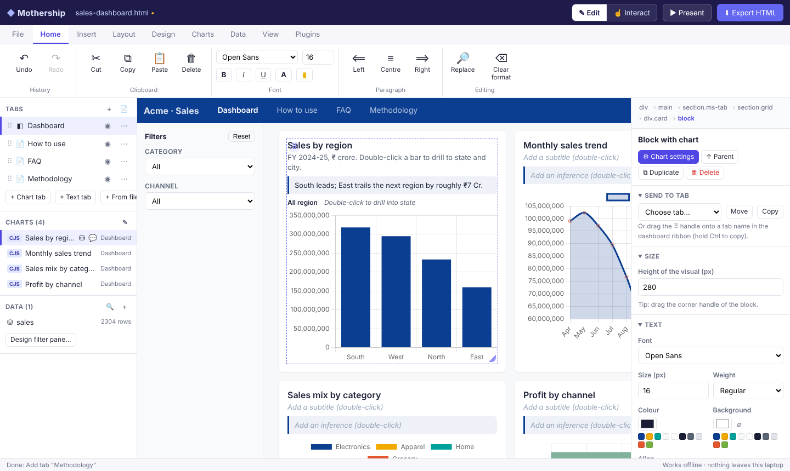
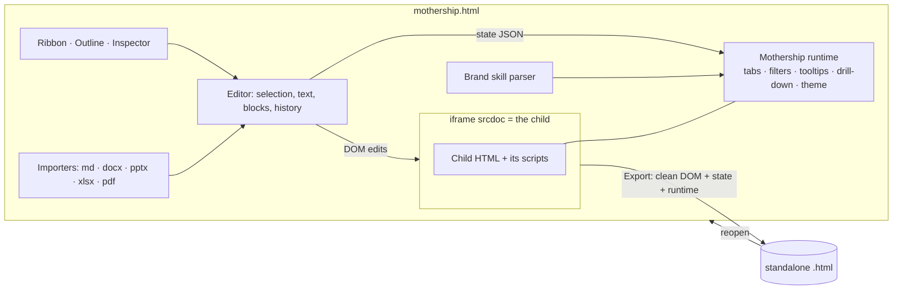

# ◆ HTML Mothership

**PowerPoint for HTML dashboards, inside one HTML file.** Open any HTML dashboard (the *child*) inside Mothership and edit it directly: text, fonts, brand colours, chart tooltips, double-click drill-downs, chart commentary, tabs, filter pane, and How-to / FAQ / Methodology pages built from Word, PowerPoint, Excel, PDF, Markdown or images. Then export one standalone `.html` file that works anywhere, offline, without Mothership.

- **Zero install, zero cost.** Double-click `mothership.html`. No server, no Node, no admin rights, no internet. Built for locked-down office laptops.
- **Nothing leaves the laptop.** Every library is bundled in `vendor/`. Files are read in the browser, and nothing is uploaded.
- **Your export *is* your project.** Reopen an exported file in Mothership to keep editing.



---

## Contents

1. [Quick start](#1-quick-start)
2. [What you can do (feature map)](#2-what-you-can-do)
3. [How-to guide](#3-how-to-guide)
4. [Files Mothership understands](#4-files-mothership-understands)
5. [Brand guidelines as a skill file](#5-brand-guidelines-as-a-skill-file)
6. [Plugins and recipes](#6-plugins-and-recipes)
7. [Saving: export, versions, autosave](#7-saving-export-versions-autosave)
8. [Security model (read this)](#8-security-model)
9. [How it works](#9-how-it-works)
10. [Limitations and known gaps](#10-limitations-and-known-gaps)
11. [Developing](#11-developing)
12. [Connect an AI assistant (MCP): Python or Node](#12-connect-an-ai-assistant-mcp)
13. [Roadmap ideas](#13-roadmap-ideas)

New to Mothership? Open it and click **Help › Guided tour** (2 minutes) or **Help › Tutorial** (7 short hands-on lessons). [`docs/TUTORIAL.md`](docs/TUTORIAL.md) has the same lessons on paper.

---

## 1. Quick start

```
HTML-Mothership/
├── mothership.html          ← double-click this
├── dist/mothership-standalone.html   ← or this: the same app in ONE file (email it / put it on a shared drive)
├── samples/                 ← three demo dashboards (Chart.js, ECharts, Plotly)
├── skills/acme-brand/       ← example brand skill (SKILL.md)
├── plugins/                 ← example plugin
└── recipes/                 ← example recipe (adds How-to / FAQ / Methodology tabs)
```

1. **Download** the repo (green *Code* button › *Download ZIP*) and unzip it anywhere, e.g. `Documents\HTML-Mothership`.
2. **Double-click `mothership.html`.** It opens in Chrome or Edge. Firefox works too, except "Save as" falls back to a normal download.
3. Click **Try a sample**, or **Open dashboard…** to load your own `.html`.
4. Edit it. Then click **Export HTML** (Ctrl+E) to save the result to your laptop.

> **Tip.** If your dashboard loads its own `.js`, `.css`, images or `data.json` from next to it, use **Open folder…** instead. Mothership bundles all of them into the single exported file, including data the page `fetch()`es.

**Which file to use?** `mothership.html` needs the `src/` and `vendor/` folders beside it. `dist/mothership-standalone.html` (about 5 MB) is fully self-contained, so you can copy just that one file.

---

## 2. What you can do

| You asked for | Where it lives in Mothership | Notes |
|---|---|---|
| Load a child HTML inside the Mothership | **File › Open / Open folder**, or drag & drop | Runs in an editable frame. Works from `file://`. |
| Edit text directly | Double-click any text (or select + Enter) | Bold/italic/underline/colour on the selected words while typing |
| Font changes | **Home › Font**, or the Inspector (right panel) | Upload brand font files under **Design › Fonts** (embedded, works offline) |
| Colour scheme from a skill file | **Design › Load brand** | Reads `SKILL.md`, `.skill`/`.zip`, or theme `.json`. Shows which of the dashboard's colours become which brand colour, then recolours page and charts. |
| What on-hover pop-ups show | Double-click a chart › **Tooltip** | Template such as `{label}: {value:cr}`, Indian formats (`inr`, `cr`, `lakh`) |
| How double-click works and drill-down levels | Chart › **Data & drill-down** | Pick dataset, levels (e.g. Region › State › City), measure. Double-click can drill, show records, or cross-filter. |
| Title, subtitle and inference before every graph | **Layout › Commentary** (all charts) or per chart | Brand check flags charts missing an inference |
| Design a filter pane | **Layout / Data › Filter pane** | Left side or top bar, cascading drop-downs, resizable |
| Tabs: create, delete, rearrange, hide | Your dashboard's own tabs: **Your tabs** (left panel) or **Layout › Add tab**. A one-page dashboard: **Layout › Tab ribbon**, then the **Tabs** list | Drag to reorder, double-click to rename. Ribbon tabs can also be hidden and have speaker notes |
| Copy / paste / move graphs across tabs | Ctrl+C / Ctrl+X / Ctrl+V, **Send to tab** in the Inspector, or drag the ⠿ handle onto a tab name | Copies are live charts, not pictures |
| Resize graphs | Drag the block's corner, or set width (1–12 columns) and height | Charts re-flow automatically |
| Resize the ribbon | Drag its bottom edge, or **Layout › Size** | Ribbon can sit on top or on the left |
| How-to, FAQ, Methodology tabs from files | **Insert › Tab from file**, or drop files | `.md .docx .pptx .xlsx .csv .pdf` and images. Headings can become collapsible FAQs. |
| Runs on a local endpoint | Yes: it's a local file | Optional `npm run serve` serves it on `localhost` |
| Load `.skills`, `.plugins`, `.json` | Drop them, or **File › Open** / **Plugins** | See [§6](#6-plugins-and-recipes) |
| **Export the child as HTML to the laptop** | **Export HTML** (top right) / Ctrl+E | Standalone file. Chrome/Edge let you choose the folder, and later saves overwrite the same file. |

### Extras added beyond the brief

| Extra | Why it matters |
|---|---|
| **Undo / redo** (Ctrl+Z / Ctrl+Y) for every edit | Safe experimentation |
| **Versions** (Ctrl+S) + **autosave & crash recovery** | Go back to any earlier state, kept in the browser |
| **Present** (F5) + **Presenter view** | Tabs become slides: arrow keys, laser pointer (L), blank screen (B), notes, timer |
| **Brand & quality check** | Off-brand colours/fonts, low contrast (WCAG), missing titles/inferences, with one-click fixes |
| **Find & replace** across the dashboard | Rename a metric everywhere at once |
| **Preview sizes** (laptop / tablet / phone) | Check the export on smaller screens |
| **Safe mode** | Opens an untrusted dashboard with its scripts blocked |
| **Network lock** | Stops the dashboard reaching the internet while you edit |
| **Data discovery** | Finds tables of data inside the dashboard's own scripts, so drill-downs need no extra file |
| **Table snapshot** block from any dataset | Quick appendix tables |
| **Print / Save as PDF** with one tab per page | Handouts |
| **Recipes** | Re-apply the same standard edits (tabs, tooltips, theme) to every new dashboard in one click |
| **Deep links** | The exported file remembers the tab in the URL (`#tab=FAQ`) |

### New in v2

| Feature | Where | What it does |
|---|---|---|
| **Fit and zoom** | Status bar (bottom right), **View › Zoom**, Ctrl + mouse wheel | The dashboard is drawn at a real desktop width (1280 px or more) and scaled down to fit the panel, so it never squashes. Zoom in to 200% to work on detail. |
| **Style anything** | Select any element, then the Inspector or **Home** | Fonts, size, colour, bold/italic/underline, line height, spacing, case, background, border, corners, shadow. |
| **Chart look** | Double-click a chart › **Look**, or **Charts › Look** | Font, size and colour of axes and legend, legend position, number format on the axis (₹, crore, lakh, %), and the pop-up's colours and font. Presets included. |
| **Hover pop-ups on anything** | Inspector › **Hover pop-up** | Add a pop-up to a KPI, a heading, an image. One style for all pop-ups (and optionally chart pop-ups too). |
| **Plain chart names** | Left panel › Outline | Charts are listed by their title (e.g. "Sales by region"), never by library names. Click one to jump to it. |
| **Data found automatically** | Chart › **Data & drill-down** | Mothership matches the chart's categories to the tables inside the page and offers "Use this data", with a sensible next drill level. Or use the numbers drawn in the chart. |
| **One category order everywhere** | **Charts › Category order** | Set North, South, East, West once. Every chart that shows those categories follows it, even if the page draws them differently. |
| **Category colours** | **Charts › Category colours** | "Retail is always green" on every chart. |
| **Format painter** | **Charts › Format painter**, or 🖌 in the Inspector | Copy one chart's look, colours, order and pop-up onto charts with the same categories, all charts, or the ones you click. |
| **Drill-down data from Markdown or Excel** | **Data › Drill-down data** | Upload a `.md` (one table under a heading naming the chart), `.xlsx` (one sheet per chart), `.csv` or `.json`. It is embedded and linked to the right chart. **Data › Template** gives you a ready-to-fill file. |
| **Build from scratch** | **File › New**, **Insert › Page** and **Insert › From data** | Header banner, sections, 2/3 columns, headings, paragraphs, callouts, dividers, spacers, buttons, page footer, KPI cards and new charts (bar, stacked, line, area, pie, doughnut) that follow filters and drill down. New dashboards can start with Overview, How to use, FAQs and Methodology tabs. |
| **Review comments → AI prompt** | **💬 Comment** mode, the **Comments pane**, or the **Review** tab | Comment on an element, a screen area, or an interaction (click, hover, filter, drill). **✨ Prompt** turns all comments into one clear prompt for any AI assistant, with rules that keep Mothership's settings intact. Copy it, save it as `.md`, or export the dashboard with the comments inside. |
| **Help** | **Help** tab | Guided tour, hands-on tutorial with automatic checks, and a searchable guide. |
| **Chart as image / chart data** | **Charts › Share** | PNG of a chart for PowerPoint or email; the chart's numbers or its linked data as CSV for Excel. |
| **Refresh data from a file** | **Data › Manage › Refresh from file** | Replace last month's embedded data with this month's. Charts, KPI cards and filters keep their settings. |
| **AI assistant connection (MCP)** | `tools/mcp/mothership-mcp.js` | Every feature above as a tool an AI assistant can use. See [§12](#12-connect-an-ai-assistant-mcp). |

### New in v3

| Feature | Where | What it does |
|---|---|---|
| **A polished editor** | Everywhere | Clean line icons instead of emoji, smoother pop-ups and menus, hover tips that show the keyboard shortcut, clearer messages with an icon and colour. |
| **Mothership's own theme** | 🎨 in the top bar, **View › Theme**, welcome screen | 8 ready-made looks (Classic, Daylight, Ocean, Forest, Saffron, Midnight, Slate dark, High contrast), light / dark / match Windows, any accent colour or **Match brand**, coloured or plain top bar, compact spacing, text size, ribbon labels or icons only. Your dashboard is not affected. |
| **Dark mode** | **View › Dark mode** | One click. |
| **Search everything (Ctrl+K)** | Top bar search, Ctrl+K | Any ribbon command, chart (jump to it or open its settings), tab, dataset, comment or help topic. |
| **A much better prompt builder** | **✨ Prompt**, or **Prompt for this one** on a comment | Each comment says exactly where it is: *Tab › Section › Card › Chart (kind) › KPI card 2 of 4*, what the chart shows and its current settings. Choose which comments (all, one tab, must-haves, or pick), the goal (apply, polish, review only, explain), who does it (chat assistant, coding agent, or an assistant with Mothership MCP) and the answer you want (finished file, list of changes, plan, or tickets). Every comment gets "Done when" checks. Live preview; copy, save `.md`, or export the file to attach. |
| **KPI status colours** | Double-click a KPI value › **Status colours** | Red / amber / green from your thresholds ("higher is better" or "lower is better"). Recalculates when filters change, and works in the exported file. |
| **Python MCP server** | `tools/mcp/mothership_mcp.py` | The same ~75 tools as the Node server, for laptops that have Python but not Node. Standard library only: no `pip install`. |
| **Python client** | `tools/mcp/python_client.py` | Drive Mothership from your own Python script: `MothershipClient().call('open_file', path=...)`. |
| **MCP how-to and FAQ** | **Help › Guide › Use with AI assistants (MCP)** and **FAQ** | Step-by-step set-up for Claude Desktop, Claude Code and Python, plus answers to office questions (IT policy, no admin, where files go). |

### New in v3.1

| Feature | Where | What it does |
|---|---|---|
| **Highcharts support** | Automatic | Highcharts dashboards get everything Chart.js, ECharts and Plotly get: plain names, look, pop-ups, one category order, category colours, data and drill-down, images, summaries. |
| **D3 / SVG charts** | Automatic | Charts drawn by D3 (or similar) are found and named. You can set pop-ups, colours and fonts, get summaries, run the number check, save an image and comment on them. They can't be redrawn from other data. |
| **Chart summaries** | **Charts › Summaries** | One or two plain sentences per chart from the numbers on screen: "West is highest at ₹4.2 Cr (38%); East is lowest at ₹1.2 Cr." Trends say what rose or fell and by how much. Add them as captions, for screen readers, or copy them all for an email. Captions follow filters and stay in the export. |
| **Number check** | **Review › Number check** | Do KPI cards match the totals of their charts? Do charts of the same measure add up alike? Rounding is allowed for; differences become review comments in one click. |
| **Excel comment tracker** | **Review › Excel tracker** / **Update from tracker** | Every comment as a spreadsheet (status, priority, tab, section, chart, where, comment, done-when, owner, due, notes) with a summary sheet. Edit it in the meeting and load it back. |
| **Compare versions** | **File › Compare** | What changed between two saved versions, now, or a file: tabs, text (old crossed out, new in green), chart settings, data, KPI cards, filters, colours, comments. Side-by-side view too. |
| **MCP tools** | Both servers | `chart_summaries`, `number_check`, `compare_versions`, `compare_file`, `save_tracker`, `load_tracker`. |

### New in v3.2: US $ by default, and publishing

| Feature | Where | What it does |
|---|---|---|
| **Region & currency** | **Design › Region & currency** | Numbers are written in **US dollars, US style** by default ($1,234,567, $1.23M). Pick any of 52 countries and any currency; choose K/M/B or lakh/crore. Applies to pop-ups and axes set to Currency or Short, KPI cards, chart summaries, the number check and AI prompts. Saved in the dashboard. A ₹, € or £ dashboard gets a hint, not a silent change. |
| **Ready to publish?** | **File › Ready to publish?** | One checklist: script errors, charts with no numbers, untitled charts, KPI totals that don't match, open must-fix comments, files that need the internet, size, title. |
| **Publish** | **File › Publish** | A view-only copy for sharing: version number (1.0, 1.1…), release note, "published by", "data as of", and a small corner badge with the release log. Comments are left out. |
| **Lock editing** | In Publish | Optional password: Mothership asks for it before editing the published copy. Only a salted key (PBKDF2) is stored. **A deterrent, not a vault** (see Limitations). |
| **Tamper check** | Automatic | A published copy carries its own SHA-256 fingerprint. Reopened in Mothership, it says "unchanged since published" or warns that it was edited elsewhere. |
| **Calm failure message** | Published files | If part of a dashboard fails to load, viewers see one line ("Part of this dashboard didn't load…") instead of a broken page. |
| **MCP tools** | Both servers | `get_locale`, `set_locale`, `publish_check`, `publish_html`; `open_file` takes a `password`. |

### New in v3.3: tabs you already have, comments like PowerPoint, colours that stay in step

| Feature | Where | What it does |
|---|---|---|
| **Your own tabs** | **Your tabs** (left panel), **Layout › Add tab** | Mothership finds the tabs your dashboard already has (buttons with `data-tab`, `aria-controls`, `href="#…"` or `onclick="openTab(…)"`). Click to switch, even in Edit mode; double-click to rename; drag to reorder; ⋯ to delete. **Add tab** makes a new tab that looks and works like the others, and Insert puts things on the tab you are looking at. The old "Tabbed layout" is now **Tab ribbon**, for one-page dashboards. |
| **Comment mode** | **💬 Comment** (next to Edit and Interact) | Click anything to comment on it, or drag a box around an area. Tabs still switch. You type in the Comments pane, not a pop-up (Ctrl+Enter adds). |
| **Pins that stay put** | Automatic | Area boxes and pins are tied to the content under them, so they move when you scroll, including inside panels with their own scroll bar, and hide when their tab isn't showing. |
| **Comments pane** | **🗨 Comments** (top), or the **Comments** tab on the right | Every comment in one list, grouped by tab, like PowerPoint. Click one to go to it; **Reply**, **Resolve**, **Edit**, ✨ prompt, delete. Filter Open / All / Must fix / Resolved. Your name on comments and replies (optional). Replies go into AI prompts too. |
| **Legend and chart colours in step** | Select a chart: **Colours** in the right panel; or click a legend entry | Change a colour once and the chart, its legend (also a legend written in the page's HTML) and every chart showing the same name follow. Recolouring a legend swatch recolours the chart. Also fixes Chart.js bars that kept their old colour on screen. |
| **Brand skills that behave the same everywhere** | **Design › Load brand** | A `.zip` is read in full and always in the same order (SKILL.md first). Before applying, a **preview** lists each colour the dashboard uses and the brand colour it becomes (main colour and shades → primary, backgrounds → background/card, text → text, lines → border; red/green status colours kept). Untick or change any row and watch the dashboard update. Optional: brand fonts everywhere (icons keep theirs). |
| **MCP tools** | Both servers | `page_tabs` (list, show, add, rename, move, delete); `set_mode` takes `comment`; `update_comment` takes `reply`; `list_comments` returns replies; `apply_theme` reports the colours it swapped. |

---

## 3. How-to guide

### Selecting and editing
- **Edit mode** (top right) is the default. Click to select. **Alt+↑** or the breadcrumb in the right panel selects the parent (e.g. the whole card). **Esc** deselects.
- **Interact mode** lets you use the dashboard normally: its own buttons, filters, tooltips, drill-downs. Switch to it to test.
- **Double-click text** to type. **Enter** finishes a heading. **Esc** cancels focus.
- The **Inspector** (right) edits font, size, weight, colour, background, alignment, width/height, padding, margin, corner radius, border, visibility and order. Brand colours appear as swatches.
- Text you edit on the page's own elements is kept even if the dashboard's script rewrites it on load (e.g. KPI values): Mothership re-applies your text after the page draws. Elements marked **script-made** are created entirely by the dashboard's code, so edits to them may be lost when the page reloads. Edit their source (chart settings, data) instead.

### Tabs and the ribbon
**If your dashboard already has tabs**, use them: they are listed under **Your tabs** in the left panel. Click to switch (in Edit mode too), double-click to rename, drag to reorder, **⋯** to add a tab after one, load a file into a new tab, or delete. **Layout › Add tab** adds one at the end. Insert puts new parts on the tab you are looking at. You don't need the tab ribbon below.

**If your dashboard is one long page:**
1. **Layout › Tab ribbon** wraps your original page into a first tab called *Dashboard* and adds a ribbon.
2. Add tabs from the left panel: **+ Chart tab** (a 12-column grid), **+ Text tab**, or **+ From file**.
3. Reorder by dragging in the Tabs list. Use **⋯** to rename, duplicate, add speaker notes, load a file into the tab, or delete. Use **◉** to hide or show.
4. **Layout › Top / Left / Size / Title** style the ribbon. You can also drag its edge.

### Charts
- **Commentary:** every chart gets *Title → Subtitle → Inference → visual*. Use **Layout › Commentary** once for all charts. Click the placeholder lines to type.
- **Move / copy:** select a chart, then **Send to tab › Move / Copy**. Or drag the ⠿ handle (top-left of a block) onto a tab name in the dashboard ribbon (hold **Ctrl** to copy). Or use Ctrl+C, switch tab, Ctrl+V.
- **Resize:** drag the bottom-right corner, or set *Width (columns)* and *Height* in the Inspector.
- **Tooltip:** double-click the chart, then the **Tooltip** tab. Placeholders: `{label} {series} {value} {pct} {total} {index}`. When the chart is bound to data, any numeric field also works, e.g. `{profit}` and `{count}`.
  Formats: `{value:inr}` → ₹1,23,45,678 · `{value:cr}` → ₹1.23 Cr · `{value:lakh}` → ₹12.35 L · `{value:k}` · `{value:m}` · `{value:pct}` · `{value:0.0}` · `{value:usd}`.
- **Drill-down:** first add data (**Data › Find data** picks up tables in the page's scripts, or **Load data** for JSON/CSV/Excel). Then open the chart's **Data & drill-down**:
  - *Show by* = the first level (e.g. `region`), *Drill to* = next levels (`state`, `city`).
  - *Value* + *Aggregate* (sum, average, count, min, max), optional *Split into series*, sort, top N.
  - *Double-click does*: drill to next level then show records · show records · cross-filter every chart · nothing.
  - A breadcrumb above the chart (`All region › South`) lets viewers climb back up.
- **Supported chart libraries:** Chart.js, Apache ECharts, Plotly and Highcharts (everything). D3 and other SVG charts: names, pop-ups, colours, fonts, summaries, number check, image and comments, but not new data or drill-down. Images and tables can still be selected, moved, copied, resized and given commentary.

### Filter pane
**Layout › Filter pane**: add filters (dataset + field), relabel, reorder, choose left or top, set a title. Drop-downs cascade, so choosing *West* limits *State* to western states. Filters apply to every chart **bound** to that dataset.

### Content tabs (How-to, FAQ, Methodology…)
**Insert › Tab from file**, or drag files onto the window:

| File | Becomes |
|---|---|
| `.md` | Formatted page. Optionally each heading becomes a collapsible question (FAQ). |
| `.docx` | Formatted page with headings, lists, tables and images. FAQ option as above. |
| `.pptx` | One card per slide: title, bullets (with levels), tables, pictures, speaker notes |
| `.xlsx / .xls / .csv` | Tables (one per sheet), and optionally datasets for filters & drill-down |
| `.pdf` | Pages as images (looks identical) **or** extracted text (searchable, editable) |
| Images | Figure with caption. Large images are downscaled to keep the export small. |

Use **Insert › Into this tab** to append to or replace an existing tab's content, and **Insert › From file** to place a document as a block next to charts.

### Present
**F5** or **▶ Present**: full screen, **→ / ←** (or PgDn/PgUp) move between tabs, **L** laser pointer, **B** blank screen, **Esc** exit. **View › Presenter view** opens a second window with the current tab, speaker notes, the next tab and a timer.

### Keyboard shortcuts
| Keys | Action |
|---|---|
| Ctrl+Z / Ctrl+Y | Undo / redo |
| Ctrl+C / X / V | Copy / cut / paste blocks (paste goes into the current tab) |
| Ctrl+D | Duplicate |
| Delete | Delete selection |
| Ctrl+B / I / U | Bold / italic / underline |
| Ctrl+F | Find & replace |
| Ctrl+S | Save a version |
| Ctrl+E / Ctrl+Shift+E | Export / Export as… |
| Ctrl+O | Open |
| Alt+↑ | Select parent |
| Alt+← / Alt+→ | Previous / next tab (also works in exported files) |
| F5 | Present |

---

## 4. Files Mothership understands

| Extension | What happens |
|---|---|
| `.html` `.htm` | Opens as the child. Exports from Mothership reopen with all settings. |
| folder | **Open folder** bundles relative scripts, CSS, images, fonts and fetched data files into one document |
| `SKILL.md` `.md` | Brand guidelines (or content: you're asked) |
| `.skill` `.skills` `.zip` | Zipped skill: `SKILL.md` + optional `theme.json`, `fonts/*.woff2`, `logo.png` |
| `.json` | Detected by shape: theme · recipe · plugin manifest · dataset (array of rows) |
| `.js` `.plugin` | Plugin (asks before running) |
| `.woff2 .woff .ttf .otf` | Brand fonts, embedded |
| `.docx .pptx .xlsx .xls .csv .pdf .md` images | Content for tabs and blocks |

Old binary `.doc` / `.ppt` can't be read in a browser. Save them as `.docx` / `.pptx` / PDF first.

---

## 5. Brand guidelines as a skill file

Mothership reads brand guidelines from a Claude-style **skill** (a `SKILL.md` with front-matter), so the same file can guide both Claude and Mothership. See [`skills/acme-brand/SKILL.md`](skills/acme-brand/SKILL.md).

It looks for these, in this order:
1. A fenced ```` ```json ```` block with `colors`, `palette`, `fonts` (most precise).
2. CSS variables such as `--brand-primary: #0B3D91`.
3. Labelled lines or table rows: `Primary: #0B3D91`, `| Background | #F7F8FA |`, `Chart palette: #.., #.., #..`, `Heading font: Montserrat`, `Body font: Open Sans`.

A `.zip` or `.skill` is read in full: `SKILL.md` first, then the other `.md` guides and `.css` files in name order (a `theme.json`/`brand.json`/`tokens.json` with `colors` wins). So the same zip always gives the same theme.

**What changes on your dashboard.** Dashboards set their own colours in their CSS, so a brand only changes the page if those colours are swapped. Before applying, Mothership shows every colour the dashboard uses with the brand colour it becomes, chosen by what the colour is used for: the most-used colour and its shades → primary (then secondary, accent, chart colours), the page background → background, light card backgrounds → surface, dark text → text, grey text → muted, lines → border. Colours on parts named like up/down/good/bad/danger are kept. Untick or change any row; the dashboard updates behind the dialog. The choice is saved in the dashboard (`theme.map`) and the swap is done with override rules, so undo or *Remove theme* puts everything back. Assistants using `apply_theme` get the same mapping without the dialog (pass `map: []` to skip it).

Colour roles: `primary secondary accent background surface text muted border ribbonBg ribbonText paneBg`. You can review and adjust everything in **Design › Edit theme** (live preview), export it as `*.theme.json`, and pick it again later from **Design › Library**.

**Fonts that work offline:** zip the skill with a `fonts/` folder (`.woff2` preferred), rename it to `brand.skill`, and load it. The fonts are embedded in the export.

Options in *Edit theme*: apply to page · **force** brand fonts/colours on every element (overrides the dashboard's CSS) · recolour charts with the palette · extra CSS · logo in the ribbon.

---

## 6. Plugins and recipes

### Recipes (`.json`, safe, no code)
A recipe is a list of edits you want on every dashboard. It is declarative, so it can't run arbitrary code. Run one with **Plugins › Run recipe** or drop the file. Example: [`recipes/standard-help-tabs.json`](recipes/standard-help-tabs.json).

```json
{ "$type": "mothership/recipe", "name": "My standard", "steps": [
  { "do": "layout", "ribbon": { "position": "top", "brand": "Acme · Claims" } },
  { "do": "theme", "theme": { "colors": { "primary": "#0B3D91" }, "palette": ["#0B3D91", "#F2A900"] } },
  { "do": "wrapCharts" },
  { "do": "tooltip", "charts": "*", "template": "{label}\n{value:cr}" },
  { "do": "addTab", "title": "FAQ", "markdown": "# FAQ\n## Question?\nAnswer." },
  { "do": "chart", "match": { "title": "Sales by region" }, "commentary": { "inf": "South leads." },
    "binding": { "dataset": "sales", "levels": ["region", "state"], "measure": "sales", "agg": "sum" } },
  { "do": "copyChart", "match": { "index": 0 }, "toTab": "FAQ" },
  { "do": "dataset", "name": "sales", "expr": "salesData" },
  { "do": "filter", "dataset": "sales", "field": "region", "label": "Region" },
  { "do": "renameTab", "from": "Dashboard", "to": "Overview" },
  { "do": "replaceText", "find": "FY24", "replace": "FY 2024-25" },
  { "do": "css", "css": ".kpi .value { font-size: 30px; }" }
] }
```
All actions: `layout theme addTab renameTab deleteTab hideTab wrapCharts tooltip chart moveChart copyChart dataset filter replaceText css`.

### Plugins (`.js`, full power, so trust required)
A plugin is a JavaScript file that calls `Mothership.registerPlugin({...})` and adds buttons to the **Plugins** ribbon tab. Installed plugins are remembered in the browser. See [`plugins/highlight-negatives.js`](plugins/highlight-negatives.js) and [`docs/EXTENDING.md`](docs/EXTENDING.md) for the API.

---

## 7. Saving: export, versions, autosave

| | What | Where it lives |
|---|---|---|
| **Export HTML** (Ctrl+E) | One self-contained `.html`: the dashboard + your edits + Mothership's small runtime (~50 KB) for tabs, filters, tooltips and drill-down | A file on your laptop. In Chrome/Edge you pick the folder once, and the next Ctrl+E overwrites the same file. |
| **Save version** (Ctrl+S) | Named snapshot | This browser's storage on this laptop (last 60 kept). **File › Versions** to restore or download. |
| **Autosave** | Every few seconds after a change | Offered back as *Recover* when Mothership reopens after a crash |

Versions are **not** a backup: clearing browser data removes them. Export the files you care about.

---

## 8. Security model

Read this before opening dashboards from other people.

- **A dashboard's own scripts run with full access inside the editor.** To edit a page live, Mothership must share an origin with it. The browser warns that "allow-scripts + allow-same-origin can escape the sandbox", and that is accurate: a malicious dashboard could reach Mothership. **Only open dashboards you trust, or use Safe mode.**
- **Safe mode** (View tab) loads the child with scripts **blocked**. You can still read it and edit text and styles. Charts won't draw.
- **Network lock** (View tab) adds a Content-Security-Policy so the child can't load or send anything over the network while you edit. It also blocks CDN-hosted libraries, so use **Open folder** for dashboards that rely on them.
- **Imported content is sanitised.** Word, PowerPoint, Markdown and HTML imports have scripts, event handlers, iframes, forms and `javascript:` links removed.
- **Plugins are code.** They show their source before installing and can be disabled or removed under **Plugins › Installed**. Recipes are data only.
- **Nothing is uploaded.** No analytics, no network calls. All libraries are local (`vendor/`).

---

## 9. How it works



- The child is loaded into an iframe through `srcdoc`, which makes it same-origin even from `file://`, so Mothership can edit its DOM directly.
- Every element in the original file is tagged `data-ms-id`. Anything the page's scripts create at runtime has no tag, so the **export strips it** and the page rebuilds it on load. That's why exported charts stay live, not screenshots.
- Settings that can't live in the DOM (theme, tooltips, data bindings, filters, text overrides) are kept as JSON in `<script id="ms-state">`. A small **runtime** reads them, in the editor and in every exported file. **Chart adapters** handle Chart.js, ECharts and Plotly.
- When tabs move content around, the export moves the page's own `<script>`s to the end of `<body>` (order kept), so a chart moved to a later tab still finds its canvas.

Deeper detail: [`docs/ARCHITECTURE.md`](docs/ARCHITECTURE.md).

---

## 10. Limitations and known gaps

Stated plainly so nothing surprises you:

- **Full chart features cover Chart.js, ECharts, Plotly and Highcharts.** D3/SVG charts get basic support (no new data or drill-down). Google Charts, Power BI embeds and similar can be moved, resized and annotated only. Adding an adapter is about 100 lines (see `A.highcharts` in `src/js/runtime.js`).
- **Drill-down and filters need row-level data** (an array of objects) in the page's scripts, a `<script type="application/json">`, or a loaded file. Charts built from pre-aggregated numbers can't drill below what they hold.
- **Edits on script-made elements** (anything the dashboard's code creates after load) can be redrawn by the page. Edits on the page's own elements are safe.
- **Pages that rebuild the whole `<body>`** (some React/Vue apps) don't suit DOM editing. Mothership is designed for "static HTML + chart library" dashboards, which is how most exported dashboards are built.
- **Turning tabs off** merges all tabs into one page. It can't be undone with Ctrl+Z, so a version is saved first automatically.
- **Versions and plugins live in one browser profile.** If IT clears browser data, they go. Exports don't.
- **PowerPoint import** keeps text, tables, pictures and notes, not exact slide layout or native PowerPoint charts. Use PDF import "as images" when you need it pixel-identical.
- **The publish lock is a deterrent, not security.** An HTML file is text: anyone can open it in Notepad, change it, or copy what is on screen. The lock stops edits in Mothership and the seal reveals changes, but only when the file is opened in Mothership. For real control use SharePoint/OneDrive/Teams view-only permissions, sensitivity labels, or send a PDF.
- **Region & currency changes Mothership's numbers only**: pop-ups and axes set to Currency/Short, KPI cards and summaries. Numbers the dashboard's own script writes (and formats picked by name, like ₹ crore) are not converted, and no exchange rates are applied.
- **Very large datasets** (more than about 50k rows) embedded via *Load data* make exports large and drill-downs slower. Link to the page's own data where possible (*Find data*).

---

## 11. Developing

No build step is needed to run or edit. Plain JavaScript (ES5-style, classic `<script>`s, because ES modules don't load from `file://`).

```bash
npm install            # Playwright, only for tests
npm test               # end-to-end: opens mothership.html from file://, edits each sample, exports, re-opens the export;
                       # then the v2 features, then the MCP server driven over stdio
npm run build          # regenerate samples/*.html, samples/samples.js and dist/mothership-standalone.html
npm run serve          # optional: http://localhost:8080
```

| Path | Purpose |
|---|---|
| `mothership.html` | Shell (ribbon, panels, stage) |
| `src/js/core.js` | Namespace, events, DOM helpers, dialogs, IndexedDB |
| `src/js/runtime.js` | **Runs inside the child and in exports**: tabs, ribbon, filters, chart adapters, drill-down, theme CSS |
| `src/js/loader.js` | Open file/folder, prepare `srcdoc`, export |
| `src/js/childedit.js` | Selection, text editing, styles, blocks, drag & drop, resize grips, clipboard |
| `src/js/history.js` | Undo/redo |
| `src/js/data.js` | Tabs, insert, chart settings, datasets, filter pane |
| `src/js/brand.js` | Skill parsing, theme editor, brand check |
| `src/js/importers.js` | md/docx/pptx/xlsx/pdf/images → HTML |
| `src/js/plugins.js` | Plugin API and recipes |
| `src/js/versions.js` | Export, versions, autosave |
| `src/js/present.js` | Presenter mode |
| `src/js/compose.js` | Build from scratch: page parts, KPI cards, new charts, new dashboard |
| `src/js/arrange.js` | Category order, category colours, format painter, chart image/CSV, drill-down data files |
| `src/js/review.js` | Review comments and the AI prompt |
| `src/js/help.js` | Tour, tutorial, guide |
| `src/js/api.js` | `MS.api`: every feature as a JSON function (used by the MCP server) |
| `tools/mcp/mothership-mcp.js` | The MCP server (stdio, no dependencies) |
| `src/js/panels.js` / `ribbon.js` / `app.js` | UI |
| `vendor/` | marked, mammoth, SheetJS, JSZip, pdf.js, and chart libs for samples (see `THIRD_PARTY_NOTICES.md`) |

After changing `src/`, run `npm run build` so `dist/mothership-standalone.html` stays in sync.

---

## 12. Connect an AI assistant (MCP)

The Model Context Protocol (MCP) lets an AI assistant such as Claude Desktop or Claude Code use Mothership directly: "open sales.html, put the regions in North, South, East, West order on every chart, make Retail green, add a FAQ tab and save it".

```
 AI assistant ──stdio──▶ MCP server ──DevTools──▶ Edge/Chrome ──▶ mothership.html ──▶ MS.api
   (any client)          (Python or Node)          (hidden window)    (the real editor)
```

**Pick the server your laptop allows.** Both have the same tools and settings, and neither needs internet, admin rights or packages.

| You have | Server |
|---|---|
| Python 3.8 or newer | `python tools/mcp/mothership_mcp.py` |
| Node.js 16 or newer | `node tools/mcp/mothership-mcp.js` |

You also need Edge or Chrome (already on most office laptops). If neither Python nor Node is allowed, MCP can't run, but everything else in Mothership still works and **✨ Prompt** gives you instructions to paste into any assistant.

**Claude Desktop:** *Settings › Developer › Edit Config* and add (change the paths to where you unzipped Mothership):

```json
{
  "mcpServers": {
    "mothership": {
      "command": "python",
      "args": ["C:\\Users\\you\\Documents\\HTML-Mothership\\tools\\mcp\\mothership_mcp.py"],
      "env": { "MOTHERSHIP_OUT": "C:\\Users\\you\\Documents\\Dashboards" }
    }
  }
}
```

For Node, use `"command": "node"` and `mothership-mcp.js`. If `python` is not found, use the full path, e.g. `C:\\Users\\you\\AppData\\Local\\Programs\\Python\\Python312\\python.exe`, or `py`.

**Your own Python code** (no MCP client needed):

```python
import sys; sys.path.insert(0, r"C:\Users\you\Documents\HTML-Mothership\tools\mcp")
from python_client import MothershipClient

with MothershipClient() as ms:                      # starts the Python server
    o = ms.call("open_file", path=r"C:\Dashboards\sales.html")
    print([c["name"] for c in o["charts"]])
    ms.call("category_order", order=["North", "South", "East", "West"])
    ms.call("add_comment", chart=o["charts"][0]["name"], text="Show ₹ crore on the axis", priority="must")
    print(ms.call("comments_prompt", assistant="mcp", scope="must")["prompt"])
    print(ms.call("export_html")["saved"])
```

`python tools/mcp/python_client.py samples/sales-dashboard.html` runs a short demo. If your office allows `pip install mcp`, the official MCP SDK works as well (see `with_official_sdk()` in that file).

**Claude Code:** the repo includes `.mcp.json`, so opening Claude Code in this folder offers the `mothership` server. Or run `claude mcp add mothership -- python tools/mcp/mothership_mcp.py` (or `-- node tools/mcp/mothership-mcp.js`).

**Tools.** About 75, generated from `MS.api` (see [`docs/EXTENDING.md`](docs/EXTENDING.md#msapi-and-the-mcp-server)), so anything new added to `MS.api` appears automatically. The main ones:

| Group | Tools |
|---|---|
| Files | `open_file`, `open_folder`, `new_dashboard`, `export_html`, `screenshot`, `chart_image`, `insert_file`, `load_data`, `drill_data_file`, `load_brand`, `save_prompt` |
| Look at it | `status`, `outline`, `find`, `get_element`, `list_comments`, `dataset_rows`, `brand_check` |
| Text and style | `set_text`, `replace_text`, `set_style`, `set_popup`, `popup_style`, `move_element`, `duplicate`, `delete` |
| Build | `insert_part`, `insert_text_block`, `insert_button`, `insert_kpis`, `kpi_status`, `insert_chart`, `insert_table`, `resize_block` |
| Tabs | `layout`, `add_tab`, `rename_tab`, `move_tab`, `hide_tab`, `duplicate_tab`, `move_chart`, `tab_notes` |
| Charts | `chart_settings` (commentary, pop-up text, look, data, drill), `chart_look_all`, `tooltip_all`, `category_order`, `category_colors`, `format_painter`, `find_chart_data`, `link_chart_data`, `drill`, `chart_data` |
| Data | `discover_datasets`, `add_dataset`, `refresh_dataset`, `drill_data`, `filter_pane`, `set_filter` |
| Review | `add_comment`, `update_comment`, `list_comments` (with *Tab › Section › Chart* for each), `comments_prompt` (scope, goal, assistant, output), `save_tracker`, `load_tracker` |
| Checks | `chart_summaries`, `number_check`, `compare_versions`, `compare_file` |
| Anything else | `undo`, `redo`, `run_recipe`, `call` (any Mothership function by name) |

**Settings** (optional `env` entries):

| Variable | Default | Use |
|---|---|---|
| `MOTHERSHIP_BROWSER` | Edge, then Chrome | Full path to `msedge.exe` or `chrome.exe` |
| `MOTHERSHIP_HEADLESS` | `1` (hidden) | `0` shows the browser window so you can watch the edits |
| `MOTHERSHIP_ATTACH` | off | Work in *your* browser window instead: start Edge with `msedge --remote-debugging-port=9222`, open `mothership.html`, and set this to `9222` |
| `MOTHERSHIP_OUT` | current folder | Where `export_html`, `save_prompt` and screenshots go when no path is given |
| `MOTHERSHIP_HTML` | `mothership.html` | Use `dist/mothership-standalone.html` instead, for example |

Exports never overwrite your original: the default name is `<name>-edited.html`. Every change is undoable, so "undo the last three changes" works too.

---

## 13. Roadmap ideas

Not built yet, roughly in order of value:

1. **Template gallery**: save a tab layout and reuse it across dashboards (partly covered by recipes today).
2. **Scheduled refresh**: re-load a local CSV/Excel and re-export in one click (manual refresh exists under Data › Manage).
3. **Conditional formatting for tables** (KPI cards have red/amber/green from v3).
4. **Presenter notes from comments**: turn resolved comments into speaker notes for Present mode.
5. **Accessibility pass**: alt text for images and a keyboard check of exports (chart summaries cover charts from v3.1).
6. **Full D3 support**: redraw D3 charts from new data, which needs knowing how each chart was built.
7. **Real access control and signing** (needs company systems, not a file): view-only SharePoint/Teams links, sensitivity labels, and signing published files with the company's certificate instead of a self-check.
8. **Usage analytics** (who opened which tab): needs a server, so it is out of scope for an offline file.
9. **Currency conversion** with a rate table you supply, for dashboards that mix currencies.
