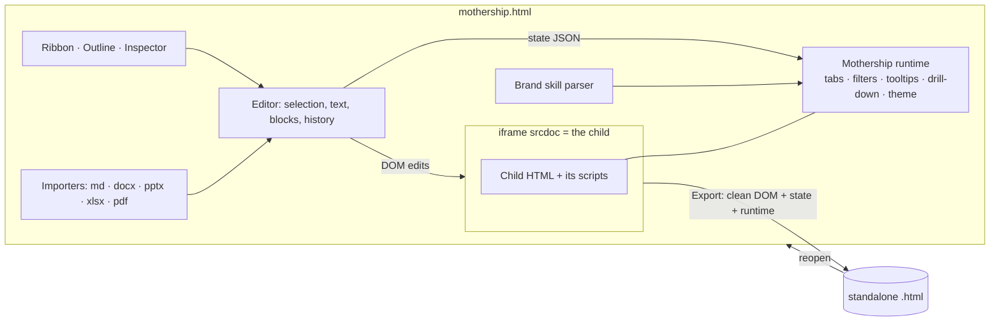

# ◆ HTML Mothership

**PowerPoint for HTML dashboards, inside one HTML file.** Open any HTML dashboard (the *child*) inside Mothership and edit it directly: text, fonts, brand colours, chart tooltips, double-click drill-downs, chart commentary, tabs, filter pane, and How-to / FAQ / Methodology pages built from Word, PowerPoint, Excel, PDF, Markdown or images. Then export one standalone `.html` file that works anywhere, offline, without Mothership.

- **Zero install, zero cost.** Double-click `mothership.html`. No server, no Node, no admin rights, no internet. Built for locked-down office laptops.
- **Nothing leaves the laptop.** Every library is bundled in `vendor/`. Files are read in the browser, and nothing is uploaded.
- **Your export *is* your project.** Reopen an exported file in Mothership to keep editing.


---

## Contents

1. [Quick start](#1-quick-start)
2. [What you can do (feature map)](#2-what-you-can-do)
3. [How-to guide](#3-how-to-guide)
4. [Files Mothership understands](#4-files-mothership-understands)
5. [Brand guidelines as a skill file](#5-brand-guidelines-as-a-skill-file)
6. [Plugins and recipes](#6-plugins-and-recipes)
7. [Saving: export, versions, autosave](#7-saving-export-versions-autosave)
8. [Security model (read this)](#8-security-model)
9. [How it works](#9-how-it-works)
10. [Limitations and known gaps](#10-limitations-and-known-gaps)
11. [Developing](#11-developing)
12. [Roadmap ideas](#12-roadmap-ideas)

---

## 1. Quick start

```
HTML-Mothership/
├── mothership.html          ← double-click this
├── dist/mothership-standalone.html   ← or this: the same app in ONE file (email it / put it on a shared drive)
├── samples/                 ← three demo dashboards (Chart.js, ECharts, Plotly)
├── skills/acme-brand/       ← example brand skill (SKILL.md)
├── plugins/                 ← example plugin
└── recipes/                 ← example recipe (adds How-to / FAQ / Methodology tabs)
```

1. **Download** the repo (green *Code* button › *Download ZIP*) and unzip it anywhere, e.g. `Documents\HTML-Mothership`.
2. **Double-click `mothership.html`.** It opens in Chrome or Edge. Firefox works too, except "Save as" falls back to a normal download.
3. Click **Try a sample**, or **Open dashboard…** to load your own `.html`.
4. Edit it. Then click **Export HTML** (Ctrl+E) to save the result to your laptop.

> **Tip.** If your dashboard loads its own `.js`, `.css`, images or `data.json` from next to it, use **Open folder…** instead. Mothership bundles all of them into the single exported file, including data the page `fetch()`es.

**Which file to use?** `mothership.html` needs the `src/` and `vendor/` folders beside it. `dist/mothership-standalone.html` (about 5 MB) is fully self-contained, so you can copy just that one file.

---

## 2. What you can do

| You asked for | Where it lives in Mothership | Notes |
|---|---|---|
| Load a child HTML inside the Mothership | **File › Open / Open folder**, or drag & drop | Runs in an editable frame. Works from `file://`. |
| Edit text directly | Double-click any text (or select + Enter) | Bold/italic/underline/colour on the selected words while typing |
| Font changes | **Home › Font**, or the Inspector (right panel) | Upload brand font files under **Design › Fonts** (embedded, works offline) |
| Colour scheme from a skill file | **Design › Load brand** | Reads `SKILL.md`, `.skill`/`.zip`, or theme `.json`. Recolours page and charts. |
| What on-hover pop-ups show | Double-click a chart › **Tooltip** | Template such as `{label}: {value:cr}`, Indian formats (`inr`, `cr`, `lakh`) |
| How double-click works and drill-down levels | Chart › **Data & drill-down** | Pick dataset, levels (e.g. Region › State › City), measure. Double-click can drill, show records, or cross-filter. |
| Title, subtitle and inference before every graph | **Layout › Commentary** (all charts) or per chart | Brand check flags charts missing an inference |
| Design a filter pane | **Layout / Data › Filter pane** | Left side or top bar, cascading drop-downs, resizable |
| Ribbon tabs: create, delete, rearrange, hide | **Layout › Tabbed layout**, then the **Tabs** list (left panel) | Drag to reorder, rename, hide, add speaker notes |
| Copy / paste / move graphs across tabs | Ctrl+C / Ctrl+X / Ctrl+V, **Send to tab** in the Inspector, or drag the ⠿ handle onto a tab name | Copies are live charts, not pictures |
| Resize graphs | Drag the block's corner, or set width (1–12 columns) and height | Charts re-flow automatically |
| Resize the ribbon | Drag its bottom edge, or **Layout › Size** | Ribbon can sit on top or on the left |
| How-to, FAQ, Methodology tabs from files | **Insert › Tab from file**, or drop files | `.md .docx .pptx .xlsx .csv .pdf` and images. Headings can become collapsible FAQs. |
| Runs on a local endpoint | Yes: it's a local file | Optional `npm run serve` serves it on `localhost` |
| Load `.skills`, `.plugins`, `.json` | Drop them, or **File › Open** / **Plugins** | See [§6](#6-plugins-and-recipes) |
| **Export the child as HTML to the laptop** | **Export HTML** (top right) / Ctrl+E | Standalone file. Chrome/Edge let you choose the folder, and later saves overwrite the same file. |

### Extras added beyond the brief

| Extra | Why it matters |
|---|---|
| **Undo / redo** (Ctrl+Z / Ctrl+Y) for every edit | Safe experimentation |
| **Versions** (Ctrl+S) + **autosave & crash recovery** | Go back to any earlier state, kept in the browser |
| **Present** (F5) + **Presenter view** | Tabs become slides: arrow keys, laser pointer (L), blank screen (B), notes, timer |
| **Brand & quality check** | Off-brand colours/fonts, low contrast (WCAG), missing titles/inferences, with one-click fixes |
| **Find & replace** across the dashboard | Rename a metric everywhere at once |
| **Preview sizes** (laptop / tablet / phone) | Check the export on smaller screens |
| **Safe mode** | Opens an untrusted dashboard with its scripts blocked |
| **Network lock** | Stops the dashboard reaching the internet while you edit |
| **Data discovery** | Finds tables of data inside the dashboard's own scripts, so drill-downs need no extra file |
| **Table snapshot** block from any dataset | Quick appendix tables |
| **Print / Save as PDF** with one tab per page | Handouts |
| **Recipes** | Re-apply the same standard edits (tabs, tooltips, theme) to every new dashboard in one click |
| **Deep links** | The exported file remembers the tab in the URL (`#tab=FAQ`) |

---

## 3. How-to guide

### Selecting and editing
- **Edit mode** (top right) is the default. Click to select. **Alt+↑** or the breadcrumb in the right panel selects the parent (e.g. the whole card). **Esc** deselects.
- **Interact mode** lets you use the dashboard normally: its own buttons, filters, tooltips, drill-downs. Switch to it to test.
- **Double-click text** to type. **Enter** finishes a heading. **Esc** cancels focus.
- The **Inspector** (right) edits font, size, weight, colour, background, alignment, width/height, padding, margin, corner radius, border, visibility and order. Brand colours appear as swatches.
- Text you edit on the page's own elements is kept even if the dashboard's script rewrites it on load (e.g. KPI values): Mothership re-applies your text after the page draws. Elements marked **script-made** are created entirely by the dashboard's code, so edits to them may be lost when the page reloads. Edit their source (chart settings, data) instead.

### Tabs and the ribbon
1. **Layout › Tabbed layout** wraps your original page into a first tab called *Dashboard* and adds a ribbon.
2. Add tabs from the left panel: **+ Chart tab** (a 12-column grid), **+ Text tab**, or **+ From file**.
3. Reorder by dragging in the Tabs list. Use **⋯** to rename, duplicate, add speaker notes, load a file into the tab, or delete. Use **◉** to hide or show.
4. **Layout › Top / Left / Size / Title** style the ribbon. You can also drag its edge.

### Charts
- **Commentary:** every chart gets *Title → Subtitle → Inference → visual*. Use **Layout › Commentary** once for all charts. Click the placeholder lines to type.
- **Move / copy:** select a chart, then **Send to tab › Move / Copy**. Or drag the ⠿ handle (top-left of a block) onto a tab name in the dashboard ribbon (hold **Ctrl** to copy). Or use Ctrl+C, switch tab, Ctrl+V.
- **Resize:** drag the bottom-right corner, or set *Width (columns)* and *Height* in the Inspector.
- **Tooltip:** double-click the chart, then the **Tooltip** tab. Placeholders: `{label} {series} {value} {pct} {total} {index}`. When the chart is bound to data, any numeric field also works, e.g. `{profit}` and `{count}`.
  Formats: `{value:inr}` → ₹1,23,45,678 · `{value:cr}` → ₹1.23 Cr · `{value:lakh}` → ₹12.35 L · `{value:k}` · `{value:m}` · `{value:pct}` · `{value:0.0}` · `{value:usd}`.
- **Drill-down:** first add data (**Data › Find data** picks up tables in the page's scripts, or **Load data** for JSON/CSV/Excel). Then open the chart's **Data & drill-down**:
  - *Show by* = the first level (e.g. `region`), *Drill to* = next levels (`state`, `city`).
  - *Value* + *Aggregate* (sum, average, count, min, max), optional *Split into series*, sort, top N.
  - *Double-click does*: drill to next level then show records · show records · cross-filter every chart · nothing.
  - A breadcrumb above the chart (`All region › South`) lets viewers climb back up.
- **Supported chart libraries:** Chart.js, Apache ECharts, Plotly. Other visuals (D3, SVG, images, tables) can still be selected, moved, copied, resized and given commentary. Their tooltips and drill-downs belong to their own code.

### Filter pane
**Layout › Filter pane**: add filters (dataset + field), relabel, reorder, choose left or top, set a title. Drop-downs cascade, so choosing *West* limits *State* to western states. Filters apply to every chart **bound** to that dataset.

### Content tabs (How-to, FAQ, Methodology…)
**Insert › Tab from file**, or drag files onto the window:

| File | Becomes |
|---|---|
| `.md` | Formatted page. Optionally each heading becomes a collapsible question (FAQ). |
| `.docx` | Formatted page with headings, lists, tables and images. FAQ option as above. |
| `.pptx` | One card per slide: title, bullets (with levels), tables, pictures, speaker notes |
| `.xlsx / .xls / .csv` | Tables (one per sheet), and optionally datasets for filters & drill-down |
| `.pdf` | Pages as images (looks identical) **or** extracted text (searchable, editable) |
| Images | Figure with caption. Large images are downscaled to keep the export small. |

Use **Insert › Into this tab** to append to or replace an existing tab's content, and **Insert › From file** to place a document as a block next to charts.

### Present
**F5** or **▶ Present**: full screen, **→ / ←** (or PgDn/PgUp) move between tabs, **L** laser pointer, **B** blank screen, **Esc** exit. **View › Presenter view** opens a second window with the current tab, speaker notes, the next tab and a timer.

### Keyboard shortcuts
| Keys | Action |
|---|---|
| Ctrl+Z / Ctrl+Y | Undo / redo |
| Ctrl+C / X / V | Copy / cut / paste blocks (paste goes into the current tab) |
| Ctrl+D | Duplicate |
| Delete | Delete selection |
| Ctrl+B / I / U | Bold / italic / underline |
| Ctrl+F | Find & replace |
| Ctrl+S | Save a version |
| Ctrl+E / Ctrl+Shift+E | Export / Export as… |
| Ctrl+O | Open |
| Alt+↑ | Select parent |
| Alt+← / Alt+→ | Previous / next tab (also works in exported files) |
| F5 | Present |

---

## 4. Files Mothership understands

| Extension | What happens |
|---|---|
| `.html` `.htm` | Opens as the child. Exports from Mothership reopen with all settings. |
| folder | **Open folder** bundles relative scripts, CSS, images, fonts and fetched data files into one document |
| `SKILL.md` `.md` | Brand guidelines (or content: you're asked) |
| `.skill` `.skills` `.zip` | Zipped skill: `SKILL.md` + optional `theme.json`, `fonts/*.woff2`, `logo.png` |
| `.json` | Detected by shape: theme · recipe · plugin manifest · dataset (array of rows) |
| `.js` `.plugin` | Plugin (asks before running) |
| `.woff2 .woff .ttf .otf` | Brand fonts, embedded |
| `.docx .pptx .xlsx .xls .csv .pdf .md` images | Content for tabs and blocks |

Old binary `.doc` / `.ppt` can't be read in a browser. Save them as `.docx` / `.pptx` / PDF first.

---

## 5. Brand guidelines as a skill file

Mothership reads brand guidelines from a Claude-style **skill** (a `SKILL.md` with front-matter), so the same file can guide both Claude and Mothership. See [`skills/acme-brand/SKILL.md`](skills/acme-brand/SKILL.md).

It looks for these, in this order:
1. A fenced ```` ```json ```` block with `colors`, `palette`, `fonts` (most precise).
2. CSS variables such as `--brand-primary: #0B3D91`.
3. Labelled lines or table rows: `Primary: #0B3D91`, `| Background | #F7F8FA |`, `Chart palette: #.., #.., #..`, `Heading font: Montserrat`, `Body font: Open Sans`.

Colour roles: `primary secondary accent background surface text muted border ribbonBg ribbonText paneBg`. You can review and adjust everything in **Design › Edit theme** (live preview), export it as `*.theme.json`, and pick it again later from **Design › Library**.

**Fonts that work offline:** zip the skill with a `fonts/` folder (`.woff2` preferred), rename it to `brand.skill`, and load it. The fonts are embedded in the export.

Options in *Edit theme*: apply to page · **force** brand fonts/colours on every element (overrides the dashboard's CSS) · recolour charts with the palette · extra CSS · logo in the ribbon.

---

## 6. Plugins and recipes

### Recipes (`.json`, safe, no code)
A recipe is a list of edits you want on every dashboard. It is declarative, so it can't run arbitrary code. Run one with **Plugins › Run recipe** or drop the file. Example: [`recipes/standard-help-tabs.json`](recipes/standard-help-tabs.json).

```json
{ "$type": "mothership/recipe", "name": "My standard", "steps": [
  { "do": "layout", "ribbon": { "position": "top", "brand": "Acme · Claims" } },
  { "do": "theme", "theme": { "colors": { "primary": "#0B3D91" }, "palette": ["#0B3D91", "#F2A900"] } },
  { "do": "wrapCharts" },
  { "do": "tooltip", "charts": "*", "template": "{label}\n{value:cr}" },
  { "do": "addTab", "title": "FAQ", "markdown": "# FAQ\n## Question?\nAnswer." },
  { "do": "chart", "match": { "title": "Sales by region" }, "commentary": { "inf": "South leads." },
    "binding": { "dataset": "sales", "levels": ["region", "state"], "measure": "sales", "agg": "sum" } },
  { "do": "copyChart", "match": { "index": 0 }, "toTab": "FAQ" },
  { "do": "dataset", "name": "sales", "expr": "salesData" },
  { "do": "filter", "dataset": "sales", "field": "region", "label": "Region" },
  { "do": "renameTab", "from": "Dashboard", "to": "Overview" },
  { "do": "replaceText", "find": "FY24", "replace": "FY 2024-25" },
  { "do": "css", "css": ".kpi .value { font-size: 30px; }" }
] }
```
All actions: `layout theme addTab renameTab deleteTab hideTab wrapCharts tooltip chart moveChart copyChart dataset filter replaceText css`.

### Plugins (`.js`, full power, so trust required)
A plugin is a JavaScript file that calls `Mothership.registerPlugin({...})` and adds buttons to the **Plugins** ribbon tab. Installed plugins are remembered in the browser. See [`plugins/highlight-negatives.js`](plugins/highlight-negatives.js) and [`docs/EXTENDING.md`](docs/EXTENDING.md) for the API.

---

## 7. Saving: export, versions, autosave

| | What | Where it lives |
|---|---|---|
| **Export HTML** (Ctrl+E) | One self-contained `.html`: the dashboard + your edits + Mothership's small runtime (~50 KB) for tabs, filters, tooltips and drill-down | A file on your laptop. In Chrome/Edge you pick the folder once, and the next Ctrl+E overwrites the same file. |
| **Save version** (Ctrl+S) | Named snapshot | This browser's storage on this laptop (last 60 kept). **File › Versions** to restore or download. |
| **Autosave** | Every few seconds after a change | Offered back as *Recover* when Mothership reopens after a crash |

Versions are **not** a backup: clearing browser data removes them. Export the files you care about.

---

## 8. Security model

Read this before opening dashboards from other people.

- **A dashboard's own scripts run with full access inside the editor.** To edit a page live, Mothership must share an origin with it. The browser warns that "allow-scripts + allow-same-origin can escape the sandbox", and that is accurate: a malicious dashboard could reach Mothership. **Only open dashboards you trust, or use Safe mode.**
- **Safe mode** (View tab) loads the child with scripts **blocked**. You can still read it and edit text and styles. Charts won't draw.
- **Network lock** (View tab) adds a Content-Security-Policy so the child can't load or send anything over the network while you edit. It also blocks CDN-hosted libraries, so use **Open folder** for dashboards that rely on them.
- **Imported content is sanitised.** Word, PowerPoint, Markdown and HTML imports have scripts, event handlers, iframes, forms and `javascript:` links removed.
- **Plugins are code.** They show their source before installing and can be disabled or removed under **Plugins › Installed**. Recipes are data only.
- **Nothing is uploaded.** No analytics, no network calls. All libraries are local (`vendor/`).

---

## 9. How it works



- The child is loaded into an iframe through `srcdoc`, which makes it same-origin even from `file://`, so Mothership can edit its DOM directly.
- Every element in the original file is tagged `data-ms-id`. Anything the page's scripts create at runtime has no tag, so the **export strips it** and the page rebuilds it on load. That's why exported charts stay live, not screenshots.
- Settings that can't live in the DOM (theme, tooltips, data bindings, filters, text overrides) are kept as JSON in `<script id="ms-state">`. A small **runtime** reads them, in the editor and in every exported file. **Chart adapters** handle Chart.js, ECharts and Plotly.
- When tabs move content around, the export moves the page's own `<script>`s to the end of `<body>` (order kept), so a chart moved to a later tab still finds its canvas.

Deeper detail: [`docs/ARCHITECTURE.md`](docs/ARCHITECTURE.md).

---

## 10. Limitations and known gaps

Stated plainly so nothing surprises you:

- **Chart features cover Chart.js, ECharts and Plotly only.** D3, Highcharts, Google Charts, Power BI embeds and similar can be moved, resized and annotated, but not given new tooltips or drill-downs. Adding an adapter is about 80 lines (see `A.chartjs` in `src/js/runtime.js`). Highcharts would be a sensible next one.
- **Drill-down and filters need row-level data** (an array of objects) in the page's scripts, a `<script type="application/json">`, or a loaded file. Charts built from pre-aggregated numbers can't drill below what they hold.
- **Edits on script-made elements** (anything the dashboard's code creates after load) can be redrawn by the page. Edits on the page's own elements are safe.
- **Pages that rebuild the whole `<body>`** (some React/Vue apps) don't suit DOM editing. Mothership is designed for "static HTML + chart library" dashboards, which is how most exported dashboards are built.
- **Turning tabs off** merges all tabs into one page. It can't be undone with Ctrl+Z, so a version is saved first automatically.
- **Versions and plugins live in one browser profile.** If IT clears browser data, they go. Exports don't.
- **PowerPoint import** keeps text, tables, pictures and notes, not exact slide layout or native PowerPoint charts. Use PDF import "as images" when you need it pixel-identical.
- **Very large datasets** (more than about 50k rows) embedded via *Load data* make exports large and drill-downs slower. Link to the page's own data where possible (*Find data*).

---

## 11. Developing

No build step is needed to run or edit. Plain JavaScript (ES5-style, classic `<script>`s, because ES modules don't load from `file://`).

```bash
npm install            # Playwright, only for tests
npm test               # end-to-end: opens mothership.html from file://, edits each sample, exports, re-opens the export
npm run build          # regenerate samples/*.html, samples/samples.js and dist/mothership-standalone.html
npm run serve          # optional: http://localhost:8080
```

| Path | Purpose |
|---|---|
| `mothership.html` | Shell (ribbon, panels, stage) |
| `src/js/core.js` | Namespace, events, DOM helpers, dialogs, IndexedDB |
| `src/js/runtime.js` | **Runs inside the child and in exports**: tabs, ribbon, filters, chart adapters, drill-down, theme CSS |
| `src/js/loader.js` | Open file/folder, prepare `srcdoc`, export |
| `src/js/childedit.js` | Selection, text editing, styles, blocks, drag & drop, resize grips, clipboard |
| `src/js/history.js` | Undo/redo |
| `src/js/data.js` | Tabs, insert, chart settings, datasets, filter pane |
| `src/js/brand.js` | Skill parsing, theme editor, brand check |
| `src/js/importers.js` | md/docx/pptx/xlsx/pdf/images → HTML |
| `src/js/plugins.js` | Plugin API and recipes |
| `src/js/versions.js` | Export, versions, autosave |
| `src/js/present.js` | Presenter mode |
| `src/js/panels.js` / `ribbon.js` / `app.js` | UI |
| `vendor/` | marked, mammoth, SheetJS, JSZip, pdf.js, and chart libs for samples (see `THIRD_PARTY_NOTICES.md`) |

After changing `src/`, run `npm run build` so `dist/mothership-standalone.html` stays in sync.

---

## 12. Roadmap ideas

Not built yet, roughly in order of value:

1. **Highcharts and D3 adapters**: the next most common dashboard libraries.
2. **Chart builder**: create a new chart from a dataset inside Mothership (bar/line/pie on bundled ECharts), not only edit existing ones.
3. **KPI card builder** bound to datasets, so values respond to the filter pane.
4. **Compare versions**: side-by-side diff of two versions' text and settings.
5. **Comments / review mode**: sticky notes on elements that are exported but hidden, for reviewer sign-off.
6. **Template gallery**: save a tab layout and reuse it across dashboards (partly covered by recipes today).
7. **Accessibility pass**: alt-text prompts for images and charts, keyboard navigation audit of exports.
8. **Scheduled refresh** for dashboards whose data is a local CSV/Excel: re-load the file and re-export in one click.
